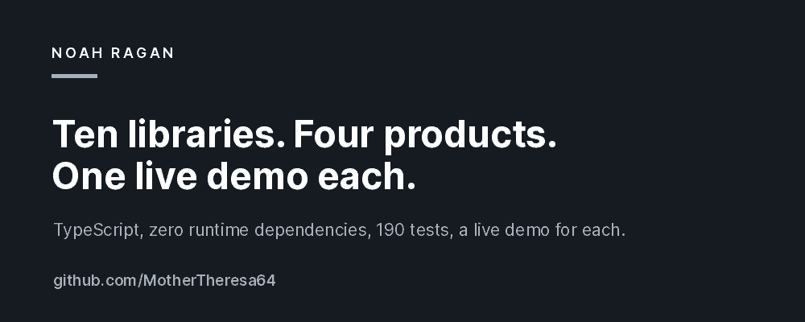

Full-stack developer building deployed, end-to-end web applications: React 19 and TypeScript front
ends, FastAPI and Flask APIs, PostgreSQL data models, automated test suites, and CI/CD.

**[Portfolio](https://noahragan-portfolio.vercel.app)** &nbsp;·&nbsp; **[LinkedIn](https://www.linkedin.com/in/njragandev/)** &nbsp;·&nbsp; **noah.j.ragan@gmail.com**

## Live applications

| Project | What it does | Stack |
| --- | --- | --- |
| **[Aegis](https://aegis-web-jvlk.onrender.com)** | Multi-tenant incident operations: alert dedupe, runbooks, realtime updates | FastAPI · PostgreSQL · Redis · Celery · React 19 |
| **[Threadline](https://threadline-ga8w.onrender.com)** | Team workspace where discussions resolve into decisions and versioned documents | React 19 · TypeScript · Express 5 |
| **[Ledgerly](https://ledgerly-web-knmt.onrender.com)** | Personal finance: transactions, transfers, budgets, savings goals | React · TypeScript · Flask · PostgreSQL |
| **[Wanderline](https://wanderline-s1yv.onrender.com)** | Shared trip planning with voting, itineraries, expenses and weather | React 19 · TypeScript · Express 5 |
| **[Planora](https://planora-zlxv.onrender.com)** | Goal, plan, milestone and task, with drag-and-drop Kanban and a Today view | React 19 · TypeScript · Express 5 |

## Ten systems libraries

Ten TypeScript libraries, zero runtime dependencies, 190 tests on Node's built-in runner, each
with a live browser demo: **[browse all ten](https://mothertheresa64.github.io/ten-demos/)**.

[Quorum](https://github.com/MotherTheresa64/Quorum) (feature flags) ·
[Relay](https://github.com/MotherTheresa64/Relay) (webhooks) ·
[Aperture](https://github.com/MotherTheresa64/Aperture) (auth) ·
[Atlas](https://github.com/MotherTheresa64/Atlas) (event-sourced documents) ·
[Ledger](https://github.com/MotherTheresa64/Ledger) (double-entry accounting) ·
[Ratchet](https://github.com/MotherTheresa64/Ratchet) (job queue) ·
[Sift](https://github.com/MotherTheresa64/Sift) (search) ·
[Cordon](https://github.com/MotherTheresa64/Cordon) (rate limiting) ·
[Beacon](https://github.com/MotherTheresa64/Beacon) (metrics) ·
[Crucible](https://github.com/MotherTheresa64/Crucible) (expression language)

## Tools

TypeScript · Python · React 19 · FastAPI · Flask · Express 5 · PostgreSQL · SQLite · Redis ·
Docker · GitHub Actions · Render · Vercel

## Background

Coding Temple, Full Stack Software Engineering (2025). Before engineering, nearly two years of
Tier 3 technical support at Vivint, diagnosing the failures that Tier 1 and Tier 2 could not.
